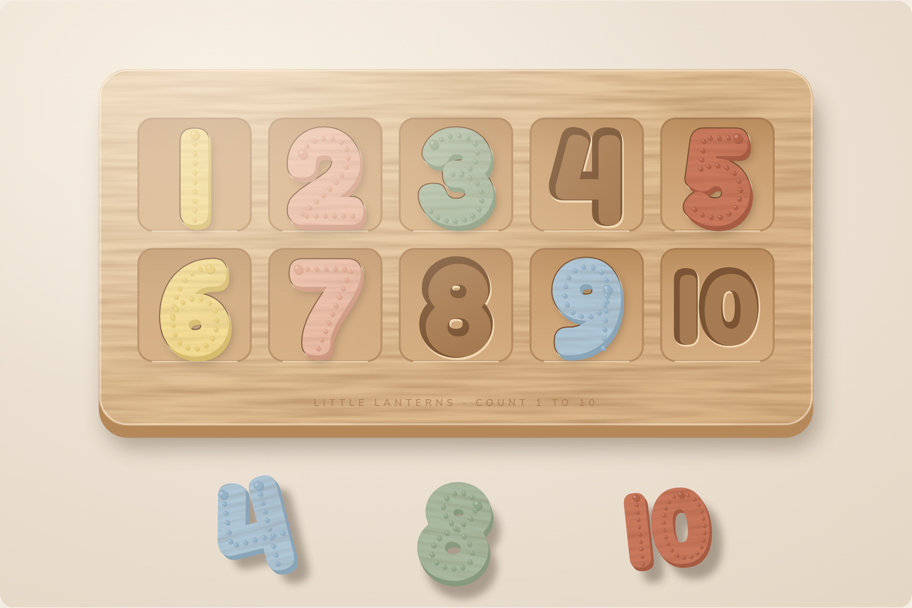

# Magnetic Rote Counting Board

Product concept for a premium wooden early-learning toy. Open [index.html](index.html) in a browser to see the full concept page.

## The idea

A solid wood ten-frame board with 10 squares in 2 rows of 5. Each square has a numeral-shaped well cut into it. Ten chunky wooden numerals, 1 to 10, each hide a sealed magnet underneath and click into their matching well, so the board works as both a counting board and an inset puzzle.

- Raised tracing dots follow each numeral's writing path, starting at a bigger dot, for sensory number formation practice.
- The 1 is a plain straight line, and the 10 uses the same 1.
- Pieces are oversized (about 8 cm tall) to avoid choking hazards.

## Learning goals

Rote counting 1 to 10, number recognition, number formation, matching and visual discrimination, problem solving, fine motor skills, hand-eye coordination and tactile feedback.

## Finish palette

| Colour | Hex | Numerals |
| --- | --- | --- |
| Butter yellow | `#F1D98B` | 1 and 6 |
| Dusty peach | `#E9B7A0` | 2 and 7 |
| Muted sage | `#A9B9A0` | 3 and 8 |
| Powder blue | `#AFC6D6` | 4 and 9 |
| Terracotta | `#C9785C` | 5 and 10 |

## Suggested build

These are starting points to confirm with a manufacturer, not tested specifications.

- Solid beech board, about 55 × 25 cm, with 10 cm squares and 3 mm rounded edges
- Numerals about 8 cm tall and 2 cm thick, with a water-based stain so the grain shows
- Numeral-shaped wells about 8 mm deep
- Tracing dots 1 to 2 mm high, carved or routed from the wood, not glued on
- Magnets fully sealed inside each piece, with a hidden steel disc under each well
- Test against toy safety standards before sale (in Saudi Arabia, SASO requirements through the SABER platform)

## Images

| File | Shows |
| --- | --- |
| [hero.png](images/hero.png) | Board with seven numerals seated and three beside it |
| [closeup.png](images/closeup.png) | Fingers lifting the 4 out of its well next to the seated 3 |
| [magnet-section.png](images/magnet-section.png) | Cutaway of the magnet and steel disc |
| [hand-scale.png](images/hand-scale.png) | A numeral next to a 3 to 4 year old's hand, to scale |

The images are illustrations, not photographs.
